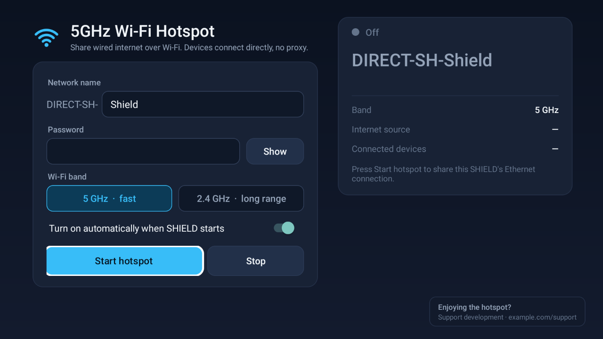

# NVIDIA SHIELD TV 5GHz Wi-Fi Hotspot: share Ethernet over Wi-Fi, no root, no proxy

Turn your **NVIDIA SHIELD TV** (or SHIELD TV Pro) into a **5GHz Wi-Fi hotspot** that shares its
**wired Ethernet internet** with your phone, laptop, console or any other device.
Connected devices get a normal IP address and full internet access automatically. There's **no proxy
to configure**, nothing to install on the devices, and **no root** needed.



**[Download the latest APK](https://github.com/dsjiffry/nvidia-shield-5ghz-hotspot/releases/latest)** ·
[How it works](docs/HOW-IT-WORKS.md) · [FAQ](#faq) · [Website](https://dsjiffry.github.io/nvidia-shield-5ghz-hotspot/)

## Why this exists

SHIELD TV has a capable dual-band Wi-Fi radio but no hotspot or tethering option in Settings.
Existing "hotspot" apps for Android TV create a *local-only* Wi-Fi Direct network and make every
device use an HTTP proxy, which breaks games, VPNs, many apps and anything that isn't a browser.

This app uses Android's own tethering service (the same NAT + DHCP your phone uses for mobile hotspot)
and points it at the SHIELD's Ethernet connection. To devices it looks like an ordinary Wi-Fi router.

## Features

- **5GHz Wi-Fi hotspot** on SHIELD TV, or 2.4GHz for longer range
- **Real routing (NAT + DHCP)**: no proxy, so games, streaming, VPNs and smart-home devices just work
- **No root**: uses Android's "Network debugging" (Developer options) instead
- **Starts automatically at boot**, and repairs itself if Wi-Fi or the hotspot drops
- **Live status on the TV**: network name, band and channel, internet source, connected devices
- **Remote-friendly** Android TV interface; the password is hidden by default
- Tiny (under 100 KB), no ads SDK, no analytics; its only network connection is to the SHIELD itself

## Requirements

- NVIDIA SHIELD TV or SHIELD TV Pro on Android 11 (SHIELD Experience 9.x). Tested on the 2019
  SHIELD TV ("tube"); other models on Android 11 should work, so reports are welcome in Issues.
- SHIELD connected to your router **by Ethernet cable**
- **Network debugging** turned on (one-time setup below)

## Install

1. Download `nvidia-shield-5ghz-hotspot-<version>.apk` from
   [Releases](https://github.com/dsjiffry/nvidia-shield-5ghz-hotspot/releases/latest).
2. Sideload it to the SHIELD, for example with the *Send files to TV* app, a USB stick plus a file
   manager, or `adb install nvidia-shield-5ghz-hotspot-<version>.apk` from a computer.

## One-time setup

1. **Settings › Device Preferences › About**: select **Build** 7 times to unlock Developer options.
2. **Settings › Device Preferences › Developer options**: turn on **Network debugging**.
3. Open **5GHz Wifi Hotspot** and choose a network name and a password (8+ characters).
4. Press **Start hotspot**. When the TV asks *"Allow USB debugging?"*, tick **Always allow** and
   press **OK**.

Your hotspot appears as **`DIRECT-SH-<your name>`** on 5GHz. Join it from any device like any other
Wi-Fi network. Leave "Turn on automatically when SHIELD starts" on, and it comes back after every reboot.

## FAQ

### Can NVIDIA SHIELD TV be used as a Wi-Fi hotspot?
Not out of the box: Android TV on SHIELD hides the hotspot feature. This app enables a real hotspot
that shares the SHIELD's Ethernet connection over Wi-Fi, on 5GHz or 2.4GHz.

### Do connected devices need a proxy?
No. Unlike PdaNet-style or "WiFi Direct + proxy" apps, devices get internet directly through
Android's built-in NAT and DHCP. Nothing needs to be configured on the phone or laptop.

### Does it need root?
No. It uses Android's Network debugging (adb over the local network) to call the system tethering
service, which is the same access a computer with adb would have. It doesn't modify the system.

### Can I use my SHIELD TV as a Wi-Fi router or access point?
Yes. A SHIELD connected by Ethernet becomes a Wi-Fi access point with its own DHCP and NAT, like a
small travel router. That's handy in hotels, dorms and offices that only give you a wired port.

### Why does the 5GHz network name start with `DIRECT-SH-`?
SHIELD's Wi-Fi firmware only allows a normal access point on 2.4GHz (5GHz channels are restricted to
"no initiating radiation" in AP mode). Wi-Fi Direct groups are allowed on 5GHz, and Wi-Fi Direct
requires network names to start with `DIRECT-xx-`. The app makes that group behave like a normal,
fully routed hotspot. In **2.4GHz** mode you can use any name.

### How fast is it?
5GHz Wi-Fi Direct on SHIELD typically runs on channels 36–48 or 149–165 with 802.11ac rates. Real
throughput depends on distance and interference, and is usually far above what proxy-based apps reach.

### Will it work on Chromecast with Google TV, Sony, TCL or other Android TV boxes?
It's built and tested for SHIELD TV on Android 11. Most newer Google TV devices lack the legacy
"Network debugging" option this app relies on, so they're not supported.

### Is Network debugging safe to leave on?
It allows adb connections from your local network, and each new computer must be approved on the TV.
Only use it on a network you trust, and don't approve debugging prompts you didn't trigger.

### The app says "Setup needed" or keeps saying "Starting…"
Make sure Network debugging is on. If no *Allow USB debugging?* prompt appears, switch Network
debugging off and on again, then press **Start hotspot** once more.

### Can I use it as a Wi-Fi repeater / extender instead?
No. The SHIELD needs a wired (Ethernet) internet connection, which the app shares over Wi-Fi.

## How it works (short version)

The app connects to the SHIELD's own adb daemon on `127.0.0.1:5555` and launches a small helper with
`app_process`, which runs as the shell user. That user holds the `TETHER_PRIVILEGED` and
`NETWORK_SETTINGS` permissions, so the helper can:

- **5GHz mode:** create a Wi-Fi Direct group on the 5GHz band, then switch it from Android's
  "local-only" mode to real tethering with Ethernet as the upstream;
- **2.4GHz mode:** start Android's standard tethered soft-AP hotspot;
- keep everything running as a watchdog, and write a status file for the TV interface.

Details: [docs/HOW-IT-WORKS.md](docs/HOW-IT-WORKS.md).

## Build from source

No Gradle needed. Requirements: JDK 17+, Android SDK `platforms;android-30` and `build-tools;34.0.0`.

```powershell
.\build.ps1                       # debug-signed APK  -> ShieldHotspot.apk
.\build.ps1 -Release              # Play bundle + release APK (needs tools\bundletool.jar)
```

Set `ANDROID_HOME` or pass `-Sdk <path>`.

## Privacy

No data collection, no analytics, no ads SDK. Settings stay on the device. See the
[privacy policy](https://dsjiffry.github.io/nvidia-shield-5ghz-hotspot/privacy.html).

## License

[MIT](LICENSE) © dsjiffry

NVIDIA and SHIELD are trademarks of NVIDIA Corporation. This project is not affiliated with or
endorsed by NVIDIA.
